# PORTIDE — Maritime Port Operations Intelligence Platform

[](PORTIDE_SELENIUM_END_TO_END_TESTING_REPORT.html)
[](https://python.org)
[](https://djangoproject.com)
[](https://react.dev)
[](https://www.typescriptlang.org)
[](https://vitejs.dev)
[](https://www.postgresql.org)
[](https://www.docker.com)

**PORTIDE** is a comprehensive, enterprise-grade Maritime Port Operations Intelligence Platform and Terminal Operating System (TOS). Designed for high-throughput modern ports, it unifies vessel scheduling, berth allocation, yard slotting, crane dispatch, regulatory customs clearance, gate security with QR verification, and public real-time container tracking into a single, cohesive, role-based platform.

---

## Table of Contents

- [Key Architectural Highlights](#key-architectural-highlights)
- [The 6-Stage Operational Tracking Pipeline](#the-6-stage-operational-tracking-pipeline)
- [Role-Based Modules](#role-based-modules)
  - [1. Port Administrator](#1-port-administrator)
  - [2. Shipping Company / Agent](#2-shipping-company--agent)
  - [3. Port Operations Officer](#3-port-operations-officer)
  - [4. Terminal & Logistics Operator](#4-terminal--logistics-operator)
  - [5. Customs Officer](#5-customs-officer)
  - [6. Gate & Truck Operations Officer](#6-gate--truck-operations-officer)
  - [7. Public Real-Time Container Tracker](#7-public-real-time-container-tracker)
- [Technology Stack](#technology-stack)
- [System Architecture](#system-architecture)
- [Quick Start & Setup](#quick-start--setup)
  - [Prerequisites](#prerequisites)
  - [Method 1: Docker Compose (Recommended)](#method-1-docker-compose-recommended)
  - [Method 2: Manual Local Setup](#method-2-manual-local-setup)
- [Environment Configuration](#environment-configuration)
- [Testing & Quality Assurance](#testing--quality-assurance)
  - [Backend Unit & Integration Tests](#backend-unit--integration-tests)
  - [Selenium Automated E2E Test Suite](#selenium-automated-e2e-test-suite)
- [API Architecture & Key Endpoints](#api-architecture--key-endpoints)
- [Repository Structure](#repository-structure)
- [License](#license)

---

## Key Architectural Highlights

- **Dual-State Container Modeling**: Decouples physical terminal handling (`container_status`) from statutory customs clearance (`container_customs_status`), preventing premature container releases while enabling real-time visibility.
- **Strict Role-Based Access Control (RBAC)**: Enforces role boundaries across 6 distinct personas with password expiration and mandatory initial password change workflows.
- **Automated Digital Gate Pass & QR Verification**: Cryptographic QR code generation with high-speed camera and file scanning for truck gates, linking Delivery Orders, approved drivers, and assigned trucks.
- **Direct Ship-to-Truck & Yard Slotting**: Supports both traditional yard staging (with bay-row-tier slot allocation) and direct vessel-to-truck discharge for expedited priority cargo.
- **Complete Audit Trail**: Immutable, queryable `AuditLog` captures every critical transaction across customs rulings, gate verifications, yard transfers, and administrative actions.

---

## The 6-Stage Operational Tracking Pipeline

Every container in PORTIDE progresses through an immutable 6-stage operational pipeline:

```mermaid
graph LR
    S1[1. Registered<br/><code>REGISTERED</code>] --> S2[2. Arrived<br/><code>ARRIVED</code>]
    S2 --> S3[3. At Terminal<br/><code>AT_TERMINAL</code>]
    S3 --> S4[4. Under Inspection<br/><code>UNDER_INSPECTION</code>]
    S4 --> S5[5. Cleared<br/><code>CLEARED</code>]
    S5 --> S6[6. Gate Exit Completed<br/><code>RELEASED</code>]
    
    style S1 fill:#1e293b,stroke:#3b82f6,stroke-width:2px,color:#fff
    style S2 fill:#1e293b,stroke:#3b82f6,stroke-width:2px,color:#fff
    style S3 fill:#1e293b,stroke:#06b6d4,stroke-width:2px,color:#fff
    style S4 fill:#1e293b,stroke:#f59e0b,stroke-width:2px,color:#fff
    style S5 fill:#1e293b,stroke:#10b981,stroke-width:2px,color:#fff
    style S6 fill:#1e293b,stroke:#6366f1,stroke-width:2px,color:#fff
```



1. **Registered**: Container registered by the shipping line against a declared vessel manifest.
2. **Arrived**: Vessel berthing completed; container marked as arrived at port limits.
3. **At Terminal**: Discharged from vessel by Quay/STS cranes to terminal yard slot or direct transfer buffer.
4. **Under Inspection**: Transferred to customs inspection zone; undergoes physical examination, document review, or hold.
5. **Cleared**: Customs officer issues formal clearance ruling; Delivery Order issuance enabled.
6. **Gate Exit Completed**: Digital Gate Pass validated at security gate; physical exit logged by gate officer.

---

## Role-Based Modules

### 1. Port Administrator
- **Company Approvals**: Review shipping agency registrations with action-required checklists and document resubmissions.
- **User Management**: Provision and manage users across all port authorities with temporary password generation and automated onboarding notifications.
- **System Audit Log**: Full visibility into system-wide activity logs filtered by category, action, and operator.
- **Gate Pass Monitoring**: Real-time analytics of gate throughput, active passes, and security anomalies.

### 2. Shipping Company / Agent
- **Vessel Declarations & Notices of Arrival**: Submit arrival schedules, ETA/ETD, and berth requests.
- **Cargo & Container Manifests**: Multi-container manifests with ISO size/type codes, seal numbers, and weight certifications.
- **Customs Documentation**: Secure upload and version-controlled amendment workflows for Bills of Lading, Commercial Invoices, and Packing Lists.
- **Pre-Arrival Customs Declarations**: Accelerated pre-clearance filings before vessel berthing.
- **Delivery Order (DO) Requests**: Automatic DO issuance upon customs release.

### 3. Port Operations Officer
- **Berth Scheduling & Planning**: Interactive berth planning across quay berths, conflict detection, and draft validation.
- **Vessel Arrival Verification**: Review arrival notices, approve ETA updates, and assign pilots/tugs.
- **Real-Time Operational Timeline**: Live vessel status tracking from anchorage to departure.

### 4. Terminal & Logistics Operator
- **Unloading Operations**: Assign Quay Cranes (STS) to vessel bays for discharge cycles.
- **Yard Master**: 2D/3D visual yard slotting engine managing Yard Blocks, Bays, Rows, and Tiers.
- **Crane Management**: Operational monitoring, job dispatch, and maintenance scheduling for STS, RTG, and RMG cranes.
- **Direct Ship-to-Truck Workflow**: Streamlined direct discharge from vessel directly onto verified transport trucks.

### 5. Customs Officer
- **Normal Customs Review**: Comprehensive container inspection interface supporting all 4 official customs decisions:
  - `CLEARED`: Formal regulatory clearance unlocking delivery and gate passes.
  - `ADDITIONAL_INFORMATION_REQUIRED`: Flags required clarifications back to the shipping line.
  - `UNDER_INSPECTION`: Orders mandatory physical container opening and examination.
  - `CUSTOMS_HOLD`: Places legal hold with mandatory justification and audit logging.
- **Pre-Arrival Review**: Pre-clearance assessments on inbound cargo prior to vessel berthing.
- **Cargo Manifest Oversight**: Read-only directory of all declared port cargo for risk analysis.
- **Customs Decision History**: Searchable, filterable audit history of every regulatory ruling.

### 6. Gate & Truck Operations Officer
- **Gate Pass Verification Desk**: Instant QR code scanner supporting camera feeds and image uploads.
- **Truck & Driver Registry**: Validation of license plates, driver IDs, and transport company credentials.
- **Gate Release Execution**: Final authorization verifying DO status, customs clearance, and physical exit recording.

### 7. Public Real-Time Container Tracker
- Clean, publicly accessible tracking portal for cargo owners and consignees.
- Real-time progress bar reflecting the 6-stage lifecycle, active timestamps, and terminal locations.

---

## Technology Stack

| Layer | Technologies |
| :--- | :--- |
| **Frontend** | React 19, TypeScript, Vite, TailwindCSS, Lucide React, Framer Motion, `jsQR`, `qrcode` |
| **Backend** | Python 3.13, Django 5.x, Django REST Framework (DRF), JWT Authentication, Argon2 / PBKDF2 |
| **Database** | PostgreSQL 16 (Production / Docker), SQLite (Local Dev & Testing) |
| **QR & Media** | Python `qrcode`, Pillow, SVG/Base64 encoding |
| **Email Service** | SMTP Gmail Integration with automatic fail-safe file-logging fallback |
| **DevOps & Containers** | Docker, Docker Compose, Multi-stage builds |
| **Testing** | Selenium WebDriver, Chromium Headless, Pytest, Django Test Runner |

---

## System Architecture

```
┌────────────────────────────────────────────────────────────────────────┐
│                        PORTIDE CLIENT (React + Vite)                  │
│  ┌──────────────┐ ┌──────────────┐ ┌──────────────┐ ┌───────────────┐  │
│  │ Port Admin   │ │ Shipping Co  │ │ Port Ops     │ │ Terminal TOS  │  │
│  └──────────────┘ └──────────────┘ └──────────────┘ └───────────────┘  │
│  ┌──────────────┐ ┌──────────────┐ ┌────────────────────────────────┐  │
│  │ Customs Desk │ │ Gate Officer │ │ Public Container Tracker Portal│  │
│  └──────────────┘ └──────────────┘ └────────────────────────────────┘  │
└────────────────────────────────────┬───────────────────────────────────┘
                                     │ REST APIs / JWT Auth
┌────────────────────────────────────▼───────────────────────────────────┐
│                    DJANGO REST FRAMEWORK BACKEND                       │
│  ┌───────────────────────┐ ┌───────────────────────┐                  │
│  │ Authentication & RBAC │ │ Mandatory Password MW │                  │
│  └───────────────────────┘ └───────────────────────┘                  │
│  ┌───────────────────────┐ ┌───────────────────────┐                  │
│  │ Vessel & Berth Engine │ │ Yard & Crane Dispatch │                  │
│  └───────────────────────┘ └───────────────────────┘                  │
│  ┌───────────────────────┐ ┌───────────────────────┐                  │
│  │ Customs Rulings (4-Way│ │ QR Digital Gate Pass  │                  │
│  └───────────────────────┘ └───────────────────────┘                  │
│  ┌───────────────────────┐ ┌───────────────────────┐                  │
│  │ Fail-safe Email Notifs│ │ Immutable AuditLog    │                  │
│  └───────────────────────┘ └───────────────────────┘                  │
└────────────────────────────────────┬───────────────────────────────────┘
                                     │
                     ┌───────────────┴───────────────┐
                     │                               │
            ┌────────▼────────┐             ┌────────▼────────┐
            │  PostgreSQL 16  │             │ Media & QR Files│
            └─────────────────┘             └─────────────────┘
```

---

## Quick Start & Setup

### Prerequisites

- **Docker & Docker Compose** (for Dockerized deployment)
- **Node.js** (v18+) & **npm**
- **Python** (v3.11+)

---

### Method 1: Docker Compose (Recommended)

Run the entire platform (PostgreSQL, Backend API, and Database migrations) in one command:

```bash
# 1. Clone repository
git clone https://github.com/Aleena-Roby/Portide.git
cd Portide

# 2. Configure environment
cp .env.example .env

# 3. Build and launch services
docker-compose up --build -d

# 4. Create initial Port Administrator account
docker-compose exec backend python manage.py create_port_admin
```

The backend API will be available at `http://localhost:8000/api/`.

Start the frontend development server:
```bash
cd frontend
npm install
npm run dev
```
Open `http://localhost:5173` in your browser.

---

### Method 2: Manual Local Setup

#### 1. Backend Setup

```bash
cd backend

# Create and activate virtual environment
python -m venv venv
# On Windows:
venv\Scripts\activate
# On Linux/macOS:
source venv/bin/activate

# Install dependencies
pip install -r requirements.txt

# Run migrations
python manage.py migrate

# Seed yard master blocks and slots
python manage.py migrate authentication 0031_seed_initial_yard_master

# Create initial Port Administrator
python manage.py create_port_admin

# Start Django development server
python manage.py runserver 8000
```

#### 2. Frontend Setup

```bash
cd frontend

# Install dependencies
npm install

# Start Vite development server
npm run dev
```

The frontend will run at `http://localhost:5173`.

---

## Environment Configuration

Configure your environment by editing `.env` (refer to `.env.example`):

```ini
# Application Configuration
SECRET_KEY="your-secure-django-secret-key"
DEBUG="True"
APP_URL="http://localhost:5173"

# Database Configuration (PostgreSQL)
POSTGRES_DB="portide_db"
POSTGRES_USER="portide_user"
POSTGRES_PASSWORD="your-postgres-password"
POSTGRES_HOST="localhost"
POSTGRES_PORT="5432"

# Email Configuration (Gmail SMTP)
EMAIL_BACKEND="django.core.mail.backends.smtp.EmailBackend"
EMAIL_HOST="smtp.gmail.com"
EMAIL_PORT="587"
EMAIL_USE_TLS="True"
EMAIL_HOST_USER="your-email@gmail.com"
EMAIL_HOST_PASSWORD="your-app-password"
DEFAULT_FROM_EMAIL="noreply@portide.io"
```

---

## Testing & Quality Assurance

### Backend Unit & Integration Tests

Run the full Django test suite covering authentication, customs, terminal operations, and gate workflows:

```bash
cd backend

# Run Customs & Regulatory tests (68 tests)
python manage.py test authentication.test_customs authentication.test_normal_customs_documents authentication.test_direct_ship_to_truck

# Run Gate Release & Digital Gate Pass tests (43 tests)
python manage.py test authentication.test_gate_release authentication.test_digital_gate_pass

# Run Terminal, Yard & Crane tests
python manage.py test authentication.test_yard_master authentication.test_yard_allocation authentication.test_crane_management authentication.test_unloading_operations

# Run complete backend test suite
python manage.py test authentication
```

### Selenium Automated E2E Test Suite

The platform includes an automated end-to-end testing suite validating all browser interactions using headless Chromium:

- **107 of 107 implemented test cases passing (100% pass rate)**.
- Full execution audit report available in [PORTIDE_SELENIUM_END_TO_END_TESTING_REPORT.html](PORTIDE_SELENIUM_END_TO_END_TESTING_REPORT.html).

```bash
# Run Phase 1: Authentication & Session Management
python tests/selenium/run_phase1.py

# Run Phase 2: Shipping Company Registration & Resubmissions
python tests/selenium/run_phase2.py

# Run Phase 3: Administrative User Management
python tests/selenium/run_phase3.py

# Run Phase 4: Vessel Notice of Arrival
python tests/selenium/run_phase4.py

# Run Phase 5: Berth Scheduling & Operational Allocations
python tests/selenium/run_phase5.py
```

---

## API Architecture & Key Endpoints

| Category | Method | Endpoint | Description |
| :--- | :--- | :--- | :--- |
| **Auth** | `POST` | `/api/auth/login/` | Authenticate user & return JWT tokens |
| **Auth** | `POST` | `/api/auth/change-password/` | Mandatory password update workflow |
| **Admin** | `GET/POST` | `/api/admin/users/` | User provisioning & management |
| **Admin** | `GET` | `/api/admin/approvals/` | Shipping company registration approvals |
| **Admin** | `GET` | `/api/admin/audit-logs/` | Query platform audit log trail |
| **Shipping** | `POST` | `/api/vessels/` | Register vessel particulars |
| **Shipping** | `POST` | `/api/vessels/arrival/` | Submit vessel notice of arrival |
| **Shipping** | `POST` | `/api/containers/` | Submit container manifest items |
| **Shipping** | `POST` | `/api/customs/documents/` | Upload / amend customs documents |
| **Customs** | `GET` | `/api/customs/containers/` | Filter containers for customs review |
| **Customs** | `POST` | `/api/customs/inspections/submit/` | Submit 4-way inspection decision |
| **Customs** | `GET` | `/api/customs/history/` | Query customs decision audit trail |
| **Terminal** | `GET/POST` | `/api/terminal/yard/master/` | Yard blocks, bays, and slot status |
| **Terminal** | `POST` | `/api/terminal/yard/allocate/` | Allocate yard slot to container |
| **Terminal** | `GET/POST` | `/api/terminal/cranes/` | Quay & Yard crane allocation |
| **Terminal** | `POST` | `/api/terminal/direct-transfer/` | Direct vessel-to-truck transfer |
| **Gate** | `POST` | `/api/gate/passes/generate/` | Generate Digital Gate Pass with QR |
| **Gate** | `POST` | `/api/gate/passes/verify/` | Scan & verify QR gate pass |
| **Gate** | `POST` | `/api/gate/passes/release/` | Record physical gate exit |
| **Public** | `GET` | `/api/public/containers/track/?query=` | Public 6-stage container tracking |

---

## Repository Structure

```
.
├── backend/
│   ├── authentication/
│   │   ├── management/commands/  # Management CLI commands (create_port_admin)
│   │   ├── migrations/           # Database schema migrations (0001 - 0038)
│   │   ├── models.py             # Domain models (Containers, Berth, Yard, GatePass)
│   │   ├── permissions.py        # Granular RBAC permission classes
│   │   ├── qr_service.py         # Cryptographic QR generation service
│   │   ├── serializers.py        # DRF serialization & validation logic
│   │   ├── urls.py               # REST route registrations
│   │   ├── views.py              # API viewsets and endpoint handlers
│   │   └── test_*.py             # Comprehensive test suites
│   ├── config/                   # Django settings, WSGI, ASGI
│   ├── Dockerfile                # Backend container image definition
│   └── requirements.txt          # Python dependencies
├── frontend/
│   ├── src/
│   │   ├── components/
│   │   │   ├── auth/             # Login, password reset, mandatory change
│   │   │   ├── common/           # Sidebar, QR scanner, error boundary
│   │   │   ├── dashboards/
│   │   │   │   ├── admin/        # User management, approvals, monitoring
│   │   │   │   ├── customs/      # 4-decision review, pre-arrival, audit history
│   │   │   │   ├── gate/         # QR verification desk, gate release
│   │   │   │   ├── shipping/     # Cargo directory, container management
│   │   │   │   └── terminal/     # Yard master, crane operations, direct-truck
│   │   │   └── landing/          # Public container tracking portal
│   │   ├── context/              # App context & authentication state
│   │   ├── services/             # Axios API client & error interceptors
│   │   └── types.ts              # TypeScript interfaces & domain types
│   ├── package.json              # Frontend dependencies & build scripts
│   └── vite.config.ts            # Vite build configuration
├── tests/
│   └── selenium/                 # Automated browser test suites & runners
├── docker-compose.yml            # Multi-container orchestration (PostgreSQL + API)
├── PORTIDE_SELENIUM_END_TO_END_TESTING_REPORT.html  # Comprehensive test report
└── README.md                     # Platform documentation
```

---

## License

This project is licensed under the [MIT License](LICENSE).
