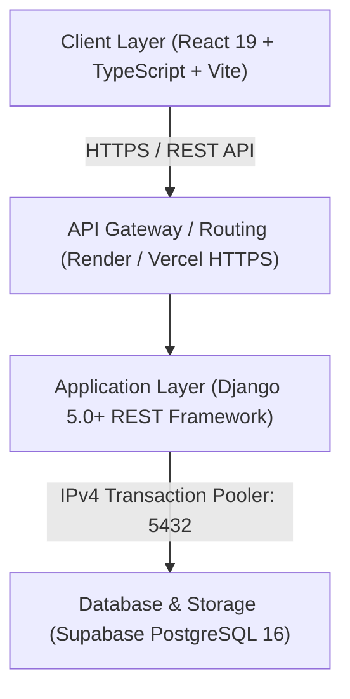

# PORTIDE System Architecture

## 1. High-Level Architecture Overview

PORTIDE is architected as a high-throughput, enterprise-grade Maritime Port Operations Intelligence Platform and Terminal Operating System (TOS). It separates concerns into three distinct layers:

---

## 2. Core Architectural Principles

### A. Dual-State Container Modeling
To prevent premature or illicit cargo release from port facilities while maximizing operational quayside throughput, PORTIDE decouples physical terminal handling from statutory customs clearance:

* **Physical Terminal Status (`container_status`)**:
  * `REGISTERED` → `ARRIVED` → `UNLOADED` → `IN_YARD` → `LOADED_ON_TRUCK` → `DEPARTED`
* **Statutory Customs Clearance (`container_customs_status`)**:
  * `NOT_SUBMITTED` → `PENDING_REVIEW` → `UNDER_INSPECTION` → `CLEARED` (or `CUSTOMS_HOLD`)

> **Security Rule**: A container CANNOT be assigned to a truck, issued a digital gate pass, or released through terminal gate barriers unless its statutory customs status is strictly `CLEARED`.

### B. Strict Role-Based Access Control (RBAC)
Platform capabilities are organized into 6 role-based personas:
1. **Port Administrator (`port_administrator`)**: Master user governance, company KYC verification, berth configuration, audit logs, and global telemetry.
2. **Shipping Company / Agent (`shipping_company`)**: Vessel fleet registry, electronic arrival requests, and cargo manifest submission.
3. **Port Operations Officer (`port_operations_officer`)**: Berth slot assignment, vessel arrival scheduling, and marine traffic coordination.
4. **Customs Authority Officer (`customs_officer`)**: Manifest analysis, high-risk flags, physical inspection scheduling, and clearance rulings.
5. **Terminal & Logistics Operator (`terminal_operator`)**: Quayside STS gantry crane discharge, yard slotting (Yard Master), container relocation, and quayside ship-to-truck dispatch.
6. **Gate & Truck Officer (`gate_officer`)**: Digital Gate Pass issuance, QR verification desk, OCR license check, and physical boom barrier release.

---

## 3. Technology Stack

* **Frontend**:
  * Framework: React 19 SPA with TypeScript
  * Bundler: Vite 6
  * Styling: Tailwind CSS & Lucide Icons
  * Telemetry Charts: Recharts
  * Hosting: Vercel ([portide.vercel.app](https://portide.vercel.app))
* **Backend**:
  * Framework: Python 3.13 / Django 5.0 REST Framework
  * WSGI / Server: Gunicorn with WhiteNoise static serving
  * Email Dispatch: Django SMTP (Gmail App Credentials)
  * Hosting: Render Web Service ([portide-api.onrender.com](https://portide-api.onrender.com))
* **Persistence & Security**:
  * Database: Supabase PostgreSQL 16 (Tokyo Region: `aws-0-ap-northeast-1.pooler.supabase.com:5432`)
  * Security: Row Level Security (RLS), bcrypt salted password hashing, mandatory initial password change enforcement.
