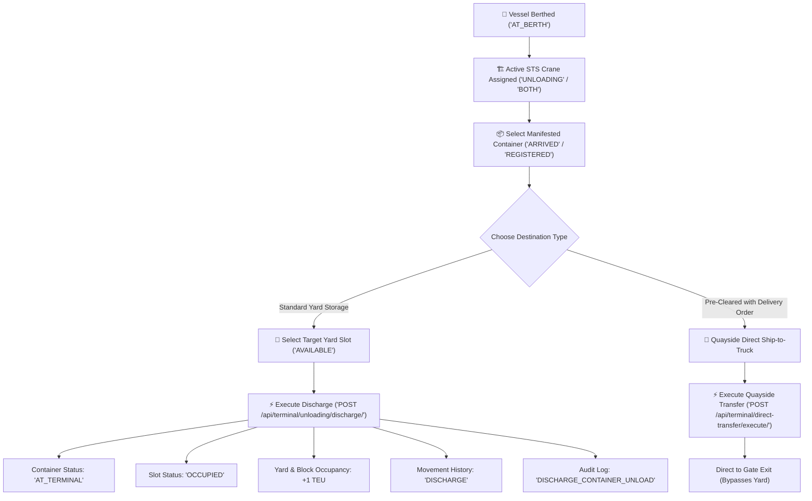
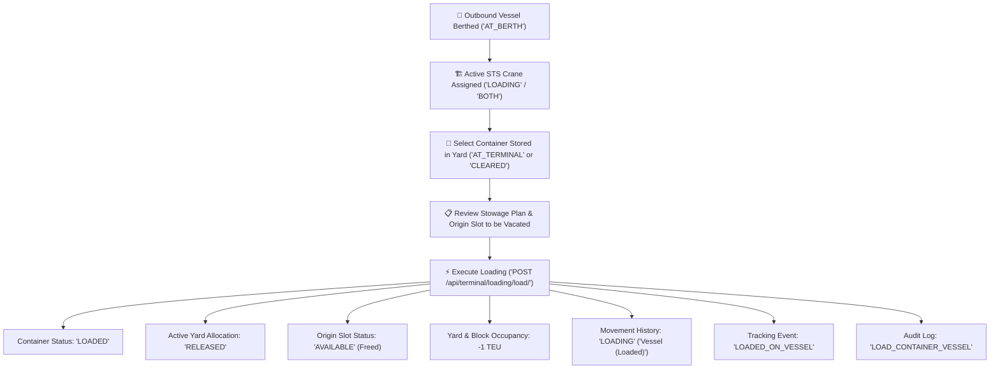
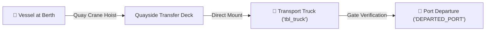

# Container Loading & Unloading Operations Flow

This document provides a simple, visual, and comprehensive guide to the **Quayside Container Loading and Unloading Operations** within the PORTIDE platform.

---

## 1. Executive Summary & Operation Comparison

Quayside container terminal operations are the physical core of a maritime port, handling two complementary flows:

| Attribute | Unloading (Vessel Discharge) | Loading (Vessel Stowage) | Direct Ship-to-Truck (Quayside Bypass) |
| :--- | :--- | :--- | :--- |
| **Origin** | Inbound Vessel at Berth | Terminal Yard Slot Coordinate | Inbound Vessel at Berth |
| **Handling Crane** | Quayside STS / MHC Crane | Quayside STS / MHC Crane | Quayside STS / MHC Crane |
| **Destination** | Available Yard Slot (Bay/Row/Tier) | Outbound Vessel at Berth | Quayside Waiting Transport Truck |
| **Slot Impact** | Slot marked `OCCUPIED` (+1 Occupancy) | Slot marked `AVAILABLE` (-1 Occupancy) | Bypasses Yard Slots completely (0) |
| **Container Status** | `ARRIVED` &rarr; `AT_TERMINAL` | `AT_TERMINAL` / `CLEARED` &rarr; `LOADED` | `ARRIVED` &rarr; `TRANSFERRED_TO_TRUCK` |
| **Movement Type** | `DISCHARGE` | `LOADING` | `DIRECT_TRANSFER` |
| **Tracking Event** | Dual-State Terminal Inbound | `LOADED_ON_VESSEL` | `DEPARTED_PORT` |

---

## 2. Inbound Unloading Flow (Vessel Discharge to Yard)

The **Unloading (Discharge)** workflow moves containers off an arriving ship and places them into an assigned coordinate slot in the container yard.

### Visual Workflow Diagram

### Step-by-Step Operator Procedure

1. **Step 1: Select Carrier Vessel at Berth**
   * Navigate to **Unloading Operations** (`/terminal/unloading-operations`).
   * The system automatically queries vessels in `AT_BERTH` schedule status.
   * Click on the active vessel card to inspect berth location and cargo volume.

2. **Step 2: Select Active Quay Crane**
   * System displays all active crane allocations (`STS` or `MHC`) assigned to this vessel whose scope permits `UNLOADING` or `BOTH`.
   * *Quick Helper*: If no cranes are active, click the **"Go to Crane Management"** button to dispatch an available crane.

3. **Step 3: Select Manifested Container**
   * Filter through manifested inbound containers by container number or cargo description.
   * The platform displays container type (`20FT`, `40FT`, `40FT_HC`), weight in MT, and customs status.

4. **Step 4: Select Destination Yard Storage Slot**
   * Choose the target **Terminal Yard** and **Yard Block**.
   * Pick an operational coordinate slot (`AVAILABLE`).
   * Slot badges clearly show Row, Bay, and Tier dimensions.

5. **Step 5: Review & Execute Discharge**
   * Review the coordinated plan summary (Vessel, Berth, Crane, Container, Yard Slot).
   * Click **Execute Container Discharge** to commit the atomic database transaction.

---

## 3. Outbound Loading Flow (Yard to Vessel Stowage)

The **Loading (Stowage)** workflow hoists export and transshipment containers out of their yard slots and stows them aboard a berthed carrier vessel, automatically freeing yard capacity.

### Visual Workflow Diagram

### Step-by-Step Operator Procedure

1. **Step 1: Select Target Carrier Vessel at Berth**
   * Navigate to **Loading Operations** (`/terminal/loading-operations`).
   * Select the outbound vessel currently berthed at the quay.

2. **Step 2: Select Active Loading Crane**
   * Pick an active STS quay crane permitted for `LOADING` or `BOTH`.
   * *Quick Helper*: If no crane is active, click **"Go to Crane Management"** to start a scheduled crane.

3. **Step 3: Select Yard Container to Load**
   * Browse containers currently stored in the yard.
   * Cards highlight current yard coordinates (e.g. `YARD-A / BLK-01 / A1-R1-B1-T1`), gross weight, and customs clearance status.

4. **Step 4: Review Loading Plan**
   * Inspect the stowage plan:
     * Destination Vessel & Assigned Berth
     * Hoisting Crane Equipment
     * Container Number & TEU Equivalent
     * **Origin Slot Coordinates that will be marked AVAILABLE upon stowage**

5. **Step 5: Confirm & Execute Stowage**
   * Click **Execute Vessel Loading**.
   * The system atomically stows the container aboard the vessel, updates the tracking pipeline, and frees the yard slot.

---

## 4. Quayside Direct Ship-to-Truck Transfer (Bypass Flow)

For urgent, perishable, or pre-cleared cargo with an approved Delivery Order, containers can bypass yard storage entirely.

* **When to use**: Containers that hold `CLEARED` customs status and an active Delivery Order (`tbl_delivery_order`).
* **Benefit**: Saves two crane moves (no yard placement and no subsequent yard pickup).
* **Execution**: Accessible directly via the **Direct Ship-to-Truck** tab inside Unloading Operations.

---

## 5. State Transition & Database Impact Matrix

Every loading and unloading operation enforces atomic synchronization between active state tables and immutable audit logs:

| Table Name | Unloading (Discharge) Impact | Loading (Stowage) Impact |
| :--- | :--- | :--- |
| `tbl_container` | `container_status = 'AT_TERMINAL'` | `container_status = 'LOADED'` |
| `tbl_yard_allocation` | Insert new record with status `'ACTIVE'` | Update existing record to status `'RELEASED'` |
| `tbl_yard_slot` | Status becomes `'OCCUPIED'` | Status becomes `'AVAILABLE'` |
| `tbl_yard_block` | Occupancy incremented: `occupied + 1` | Occupancy decremented: `max(0, occupied - 1)` |
| `tbl_yard` | Occupancy incremented: `occupied + 1` | Occupancy decremented: `max(0, occupied - 1)` |
| `tbl_yard_movement_history` | Log inserted (`movement_type='DISCHARGE'`) | Log inserted (`movement_type='LOADING'`, to_slot=NULL) |
| `tbl_container_tracking_event` | Emitted status update | Emitted status: `'LOADED_ON_VESSEL'` |
| `tbl_audit_log` | Action: `'DISCHARGE_CONTAINER_UNLOAD'` | Action: `'LOAD_CONTAINER_VESSEL'` |

---

## 6. Common Operator Scenarios & Troubleshooting

### Scenario A: "No Berthed Vessels Available"
* **Cause**: Vessel has not reached `AT_BERTH` schedule status.
* **Resolution**: Ensure the Shipping Company has an approved Arrival Request, and the Port Operations Officer has scheduled and marked the vessel `AT_BERTH` in **Berth & Scheduling** (`/operations/scheduling`).

### Scenario B: "No Active Unloading/Loading Crane"
* **Cause**: Quay cranes have not been assigned to the vessel schedule, or the assigned crane is still in `SCHEDULED` status instead of `ACTIVE`.
* **Resolution**: Click the **"Go to Crane Management"** button or navigate to `/terminal/crane-management` and click **"Start Crane"** to activate the allocation.

### Scenario C: "No Operational Slots Available"
* **Cause**: Selected yard block has reached 100% capacity.
* **Resolution**: Select another yard block or create new slot allocations in **Yard Master** (`/terminal/yard-master`).
